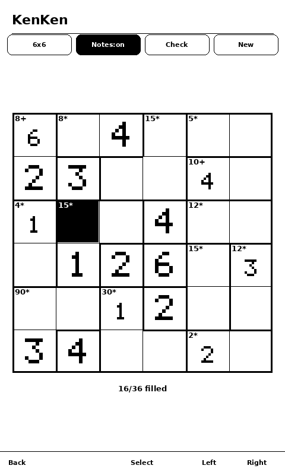

# CrossPoint + KenKen (Xteink X4 / X3)

A fork of [`crosspoint-reader-apps`](https://github.com/zakerytclarke/crosspoint-reader-apps)
(itself a fork of CrossPoint Reader) that adds a **KenKen** app to the Apps menu:
puzzles generated on the device, played entirely with the seven physical buttons,
and repainted **per cell** instead of a full-screen refresh on every keypress.

If you are picking this up cold: read "Build and flash" and "Where the code
lives" below, then `CLAUDE.md` for the working rules.



## Hardware

ESP32-C3 (single-core RISC-V @160 MHz, ~380 KB SRAM, no PSRAM), 16 MB flash,
4.26" 800x480 1-bit e-paper, microSD, WiFi 2.4 GHz, 7 buttons (4 front + 2 side +
power), no touchscreen.

## What this build adds

| Change | File |
|---|---|
| KenKen game (UI, input, repaint logic) | `src/activities/kenken/KenKenActivity.{h,cpp}` |
| Puzzle generator + uniqueness solver | `src/activities/kenken/KenKenPuzzle.{h,cpp}` |
| App registration + menu icon | `src/activities/AppRegistry.cpp`, `src/components/themes/{BaseTheme.h,lyra/LyraTheme.cpp}`, `src/components/icons/kenken{24,32}.h` |
| Windowed panel-update helper (present, **unused** — see "Refresh behaviour") | `lib/GfxRenderer/GfxRenderer.{h,cpp}` (`displayWindow`), `lib/hal/HalDisplay.{h,cpp}` (passthrough) |

Base is CrossPoint **1.3.0** (`[crosspoint] version` in `platformio.ini`). It does
**not** include upstream CrossPoint 2.0's SD-plugin system or dictionary — this is
the apps fork plus KenKen.

## Playing

- **Left / Right / Up / Down** — move the cursor. **Up** from the top row enters
  the toolbar, **Down** returns to the grid.
- **Confirm** on a cell — edit. **Left / Right** cycle `1..n` then blank,
  **Confirm** commits, **Back** cancels.
- **Confirm** on the toolbar — `Level` (4x4 → 5x5 → 6x6), `Notes` (pencil-mark
  mode), `Check` (underline wrong cells), `New`.
- **Back** — leave the app.

Cages show `11+`, `3-`, `24*`, `4/` in the top-left cell; single-cell cages are
printed as a plain given digit.

## Refresh behaviour

E-ink does not need a full-screen *flash* per keypress, and this build doesn't do
one — but it deliberately does commit a full frame:

- drawing is per-cell: a cursor move redraws two cells (73x73 px) into the
  persistent framebuffer, a value commit redraws one cell plus the status band;
- the commit is one ordinary `displayBuffer(FAST_REFRESH)` — the same path every
  other screen in the firmware uses, which is why it looks like menu navigation
  rather than a flash;
- every 100 input-driven repaints (and on New / level change) the panel gets a
  `FULL_REFRESH` to clear accumulated ghosting.

The dirty-rect bookkeeping keeps drawing cheap; only the panel transfer is a full
frame (~48 KB, ~12 ms).

A windowed commit (`GfxRenderer::displayWindow` → `HalDisplay::displayWindow` →
`EInkDisplay::displayWindow`) exists in the tree but is **not used**. It was tried
first and reverted: upstream marks that SDK path EXPERIMENTAL, its declaration in
`GfxRenderer` was commented out, no shipping activity had ever called it, and it
drives the panel with the generic fast-refresh sequence rather than the
partial-update sequence (`0x21 = 0x00`, `0x22 = 0xFC`) the SSD1677 guide specifies
for bounded updates — so a windowed refresh does not get the temperature-loaded
waveform a partial update expects. Full-frame commits are correct by
construction.

## Build and flash

Requires PlatformIO (vanilla 6.2.0 was used) and the submodule:

```bash
git clone <this repo> && cd <repo>
git submodule update --init --recursive     # open-x4-sdk: display driver + HAL
python3 -m venv .venv && .venv/bin/pip install -U platformio
export PATH=$PWD/.venv/bin:$PATH
pio run -e default                          # env:default == X4/X3
```

First build downloads ~4 GB of toolchain (~8 min); incremental builds are ~30 s.
The image lands at `.pio/build/default/firmware.bin`, currently 6.02 MB — 91.9%
of the 6.25 MB app partition.

Flash the app partition (keeps settings and WiFi credentials):

```bash
esptool --chip esp32-c3 --port /dev/ttyACM0 --baud 460800 write_flash 0x10000 .pio/build/default/firmware.bin
```

or use the community web flasher (crosspointreader.com), pick X4, "Custom .bin".

No prebuilt image is committed (the 6 MB binary does not belong in git); build
it with `pio run -e default` or `./build.sh`, which drops it in
`bin/crosspoint-kenken.bin`.

## Status / caveats

- Generator, solver, cage arithmetic and layout maths are host-tested; generation
  timing measured on an x86 desktop: 4x4 0.02 ms, 5x5 0.05 ms, 6x6 0.31 ms (worst
  case 6 attempts after retrying non-unique boards). On the C3 that is tens of
  milliseconds.
- **Not yet run on physical hardware.** It compiles, symbols are checked, and the
  layout exists only as a mockup. Button feel, long-session ghosting and battery
  cost are unverified.
- `EInkDisplay::displayWindow` allocates a small `std::vector` per call (SDK
  code, unchanged). Windows are one or two cells — a few hundred bytes — but it is
  not a zero-allocation path.
- Puzzle strings ("Notes:on", "Check", "Solved!", ...) are hardcoded English,
  unlike the rest of the UI which uses `tr()`.

## Where the code lives

```
src/activities/kenken/     KenKen app (UI + generator)
lib/GfxRenderer/           drawing + the windowed update helper
lib/hal/                   hardware abstraction, including the display passthrough
open-x4-sdk/               submodule: panel driver, LUTs, input, storage
bin/                       build output (ignored by git)
docs/                      upstream documentation (markdown only) (docs/fork-readme.md = the base fork's README)
```
